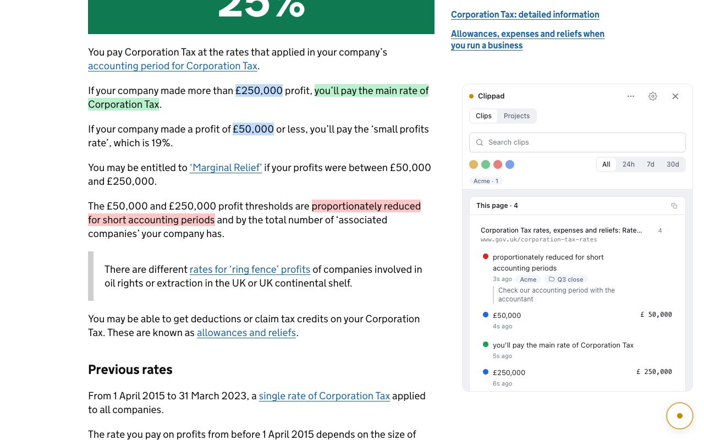
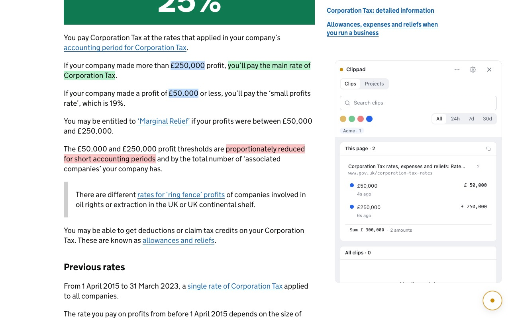
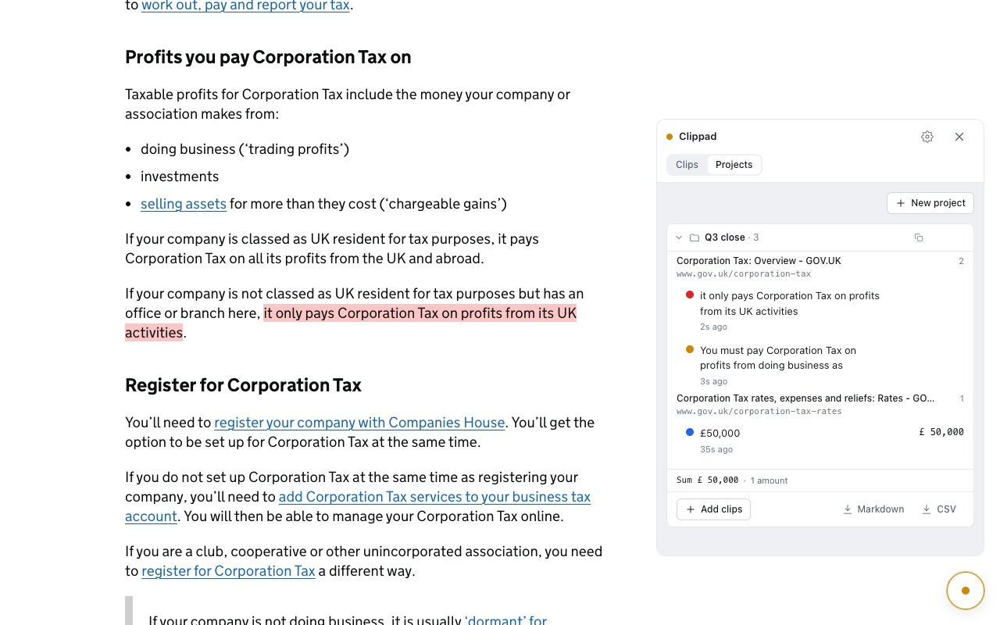

# Clippad

Clippad is a Chrome extension that lets you clip text from any page with a colour, tags, and a note, and takes you back to that spot later.

**Install:** [Clippad on the Chrome Web Store](https://chromewebstore.google.com/detail/clippad/kbgpjmllkbeffigpohpflopbmkcdjdbo)

- Product page: https://kinu01.github.io/clippad/
- Older test builds: see [Releases](https://github.com/kinu01/clippad/releases).

I built Clippad for my friend Ire. You highlight text on a web page, and later one click takes you back to that exact spot, even in a long chat thread. It's especially useful when you study with ChatGPT.

## How it works

1. Select text on a web page, and a small colour bar appears above it.
2. Pick one of four colours, or add a note. Clippad saves the clip on your computer.
3. When you come back to the page, Clippad finds the text again and highlights it.
4. The panel lists your clips. You can search, filter, group clips into projects, add up the amounts, and export to Markdown or CSV.
5. Click a clip, and Clippad opens its page and scrolls to it.

## Decisions

- **Everything stays on your computer,** because clips are text from the pages you read. There is no account, no analytics, and no network connection. Clips are kept in the extension's own IndexedDB storage.
- **A clip is saved as its words plus up to 32 characters on each side, not as a position on the page,** because pages change. When the text moves, Clippad finds it by its words. When the same words appear twice, the words around them pick the right one. If Clippad cannot find a clip with confidence, it marks it "Page changed" instead of guessing, so it never shows a highlight in the wrong place.
- **Highlights are painted by the browser, with the CSS Custom Highlight API,** so Clippad never edits the page you are reading.
- **To find a clip in a long chat, Clippad scrolls up first, one screen at a time,** because chat apps only keep the messages near the screen in the page, and a chat opens at its newest message, so older clips sit above. If the clip is not found, the page goes back to where it was.
- **The floating panel is the default, and Chrome's side panel is a setting,** because the floating panel takes no browser width and stays on the page you are on. The side panel is there for people who want a stronger boundary: a web page cannot draw over it.
- **A web page can only reach its own clips,** because the part of Clippad that runs inside a page is the least trusted part. Every message is checked in the background, and a page cannot read, create, or change clips for another site.

## Privacy

Read the [privacy policy](https://kinu01.github.io/clippad/privacy/) for what Clippad stores and how to delete it.

## Built with

TypeScript, React 18, Plasmo (Chrome Manifest V3), Tailwind CSS 4, and IndexedDB, plus my own packages `@kinu01/re-anchor`, `@kinu01/canonical-url`, and `@kinu01/parse-amounts`.

This repository holds the product page and the release builds. The source code is in a separate, private repository.
